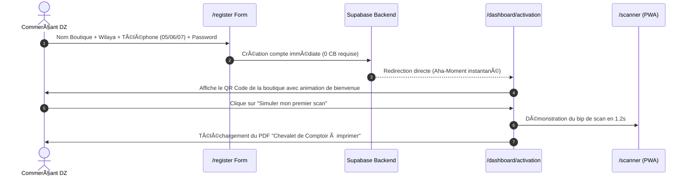

# FidelityDZ — CRO, Frictionless Onboarding & In-App Paywall Architecture

> **Conversion Rate Optimization & User Lifecycle Specification**  
> *Engineered via CRO, Signup, Onboarding & Paywalls Skills*  
> *Target: Algerian Commerçants & Cashiers across all 58 Wilayas*

---

## 1. Landing Page CRO Audit & Conversion Enhancements

### Key Friction Points Identified in Standard SaaS for Algeria
1. **Fear of Complex Technology:** Traditional merchants think they need expensive bar-code hardware or a computer.
   - **Fix:** Prominent badge: *"Fonctionne sur n'importe quel smartphone Android ou iPhone (0 matériel requis)"*.
2. **Fear of Foreign Currency / Credit Card:** 90% of Algerian merchants do not have Visa/Mastercard.
   - **Fix:** Display Algerian payment badges right below the primary CTA button: **Edahabia, CIB, Chargily Pay, BaridiMob, CCP**.
3. **Fear of Slow Internet / Customer Refusal:** *"Le client ne voudra pas télécharger une app"*.
   - **Fix:** Bold benefit statement: *"Le client n'installe AUCUNE application. Il scanne le QR code avec son appareil photo en 2 secondes."*

---

## 2. The 60-Second Frictionless Signup & Activation Flow

### Form Optimization (Mobile-First):
- **Inputs cut to minimum (4 fields only):**
  1. Nom de votre commerce (ex: Café Didouche, Boutique Sarah)
  2. Wilaya (dropdown 58 wilayas algériennes)
  3. Numéro de téléphone portable (05, 06 ou 07)
  4. Mot de passe
- **Instant SMS/WhatsApp Verification:** Optional on Day 1, strictly required only before paying subscription, to prevent signup drop-off.

---

## 3. In-App Paywall Moments & Feature Gate Triggers

### Trigger A: Le Trophée des 50 Scans (Activation Joy Paywall)
- **Moment:** Le commerçant enregistre son 50ème client pendant son essai gratuit de 7 jours.
- **Micro-copy Paywall:**
  > *« Félicitations ! Vous venez de franchir la barre des 50 clients fidélisés avec FidelityDZ ! 🚀  
  > 70% de ces clients reviendront dans votre boutique ce mois-ci.  
  > Pour continuer à scanner sans interruption et débloquer les relances WhatsApp automatiques, confirmez votre abonnement Pro à 5,900 DA / mois. »*
- **Action Buttons:**
  - `[ Payer en ligne par Edahabia / CIB (Chargily) ]`
  - `[ Payer par BaridiMob / Virement CCP ]`

### Trigger B: La Fin d'Essai J+7 (Grace Period Dunning)
- **Moment:** Jour 7 à 00:00.
- **Policy:** Pas de blocage brutal ! Le scanner continue de fonctionner pendant **48 heures de grâce**, avec une bannière ambrée au sommet du scanner :
  > *« Période d'essai terminée. Vos cartes clients restent actives pendant 48h. Activez votre compte pour ne perdre aucun client. »*

### Trigger C: Le Deuxième Caissier (Multi-Cashier Upsell)
- **Moment:** Le gérant tente de connecter un second appareil dans `/scanner` sur le forfait Solo.
- **Paywall Modal:**
  > *« Besoin de faire scanner par plusieurs serveurs ou caissiers en même temps ?  
  > Le forfait Pro permet jusqu'à 3 scanners simultanés avec codes PIN individuels. »*
