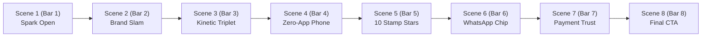

# FidelityDZ — High-End Motion Video Production Engine & B-Roll Pipeline

> **Master Audio-Visual Production Specification**  
> *Combining: Explainer-High-Energy + Dadam-Viral-Reel + Arabic-Reel-Captions + Sound-Effects + Cinematic-Video-Prompt-Skill*  
> *Target: 15s High-Energy Motion Graphics Promo & 60s Coach Dadam B2B Viral Master Reel*

---

## 1. 15-Second High-Energy Motion Graphics Promo (128 BPM Beat Grid)

- **Duration:** 15.0 Seconds (8 Bars at 128 BPM ≈ 0.46875s per beat, 1.875s per bar)
- **Aspect Ratio:** 9:16 Vertical (1080×1920) for Instagram Reels, TikTok, and YouTube Shorts
- **Audio Profile:** High-energy synthesised electronic trap/hybrid synth with sub-bass drop on Bar 2, crisp mechanical clicks, whooshes, and celebratory Ka-Ching.



### The Exact Beat Sheet (Frame-Accurate at 60 FPS)

| Bar & Time | Visual State & Motion Graphic | Audio & SFX Cue | Kinetic Text / Typography |
| :--- | :--- | :--- | :--- |
| **Bar 1 (0.00s – 1.87s)**<br/>Frames 0 – 112 | Fond noir obsidienne (`#020617`) avec grille millimétrique subtile. Une étincelle dorée (`#F59E0B`) apparaît au centre, pulse, s'étire en une ligne horizontale fine puis **inonde l'écran en vert émeraude algérien** (`#059669`). | Montée de synthé montante (riser) + son de tension statique + impact basse au flood. | `ALGERIE — 2026`<br/>*Police Mono 18px* |
| **Bar 2 (1.87s – 3.75s)**<br/>Frames 113 – 225 | **Brand Slam:** Les lettres de **FIDELITYDZ** tombent en cascade sur des doubles-croches consécutives. Le point final du logo se détache et grossit pour former un cadre QR carré. | Impact sub-bass puissant (kick 808) + son de frappe mécanique sur chaque lettre. | **FIDELITYDZ**<br/>*Grotesk Bold 92px*<br/>*Kicker: "N°1 DE LA FIDÉLITÉ DIGITALE"* |
| **Bar 3 (3.75s – 5.62s)**<br/>Frames 226 – 337 | **Kinetic Triplet:** Trois mots percutants alternés toutes les 2 pulsations (beats) avec inversion des contrastes :<br/>Beat 1: **SCAN.** (fond blanc, texte noir)<br/>Beat 3: **TAMPONNE.** (fond vert, texte or)<br/>Beat 5: **FIDÉLISE.** (fond sombre, texte néon) | Percussion claquante (rimshot métallique) synchronisée sur chaque changement de mot. | **SCAN.**<br/>**TAMPONNE.**<br/>**FIDÉLISE.** |
| **Bar 4 (5.62s – 7.50s)**<br/>Frames 338 – 450 | Mockup 3D smartphone flottant au centre. La caméra du smartphone s'ouvre, vise le QR code comptoir. Une onde laser verte traverse le code. Un badge flottant surgit : *"0 App à Télécharger"*. | Son de numérisation optique (scanner barcode bip) + son de validation aigu. | **"100% PWA — ZÉRO TÉLÉCHARGEMENT"** |
| **Bar 5 (7.50s – 9.37s)**<br/>Frames 451 – 562 | Zoom sur la carte de fidélité digitale du client. Dix cercles de tampons s'illuminent en cascade d'étoiles dorées (1, 2, 3.. 10). Au dixième tampon, une pluie de confettis dorés jaillit. | Son de machine à sous en rafale (tick-tick-tick) + **Ka-Ching de caisse enregistreuse** (`cash-register-001.ogg`). | **"10ÈME VISITE = CADEAU !"** |
| **Bar 6 (9.37s – 11.25s)**<br/>Frames 563 – 675 | Une bulle de notification WhatsApp officielle glisse du haut avec une icône animée : *"Salam Karim! Il te reste 1 café pour débloquer ton cadeau gratuit"*. Le taux de retour s'affiche : **+68% de rétention**. | Bip de notification smartphone officiel (`ui-blip-002.ogg`) + son de swoosh rapide. | **"RELANCE WHATSAPP 1-CLIC"** |
| **Bar 7 (11.25s – 13.12s)**<br/>Frames 676 – 787 | Badges de confiance algériens qui se verrouillent sur une ligne avec des reflets métalliques : **Edahabia, CIB, Chargily Pay, BaridiMob**. | Sons de clics mécaniques de verrouillage (lock sounds) en cascade. | **"PAIEMENT 100% ALGÉRIEN SÉCURISÉ"** |
| **Bar 8 (13.12s – 15.00s)**<br/>Frames 788 – 900 | **Final Hero CTA:** Le logo FidelityDZ avec le slogan officiel en arabe et français, URL du site, et bouton pulsant *"Essai 7 Jours Gratuit"*. | Accord final triomphal (synth chord swell) avec réverbération naturelle. | **fidelitydz.com**<br/>**"جرب مجاناً لمدة 7 أيام"** |

---

## 2. Coach Dadam Style 60s B2B Viral Master Reel Workflow

```
[Raw Microphone Voice] 
    → Python DSP 4-Stage Denoise (-69 dB noise floor)
    → Ludovico Einaudi "Experience" edit (-22.5 dB ducking)
    → Cinematic Impacts + SFX whooshes
    → Full-Screen Retail B-Rolls (1080x1920 cover)
    → Word-by-Word Kinetic Darja Captions (Alexandria + Cairo)
    → Broadcast Master Export (60 FPS, Angle GL, Bitrate 18 Mbps)
```

### The Word-by-Word Caption Architecture
- **Arabic Script:** Strictly for Darija and Arabic terms (`مول الحانوت`, `الكليون`, `كارطة الكارطون`, `باطل`).
- **Latin Script:** For technical SaaS terms (`FidelityDZ`, `QR Code`, `PWA`, `WhatsApp`, `Dashboard`).
- **Active Word Styling:** Springs to scale `1.18` with glowing sovereign amber `#F59E0B` and drop-shadow `0 8px 24px rgba(0,0,0,0.9)`.

---

## 3. Cinematic AI B-Roll Prompt Library (Midjourney / Kling / Runway Gen-3)

Use these exact prompts to generate photorealistic, ultra-high-definition vertical footage matching Algerian retail environments:

### Prompt 1: Coffee Shop & Latte Art Barista in Algiers
```text
cinematic vertical 9:16 footage, a young stylish Algerian barista in a modern high-end minimalist coffee shop in Sidi Yahia Algiers, pouring intricate latte art into a ceramic cup, warm morning sunlight streaming through large glass windows, polished marble counter, clean bokeh background, 35mm film grain, 8k resolution, photorealistic, cinematic color grading --ar 9:16 --v 6.1
```

### Prompt 2: Instant QR Scan at Cash Register Counter
```text
close-up macro vertical 9:16 shot of an elegant customer hand holding an iPhone with a glowing green digital loyalty pass on the screen, scanning a sleek wooden and acrylic QR code stand on a restaurant counter, subtle green light confirmation beam, hyper-detailed, high-end retail aesthetic, commercial lighting, 60fps cinematic look --ar 9:16 --v 6.1
```

### Prompt 3: Happy Store Owner Checking Booming Analytics
```text
vertical 9:16 portrait of a smiling Algerian boutique owner in his 30s standing proudly inside his stylish men's clothing store in Didouche Mourad Algiers, checking his tablet showing rising sales graphs in emerald green, warm ambient boutique lighting, racks of crisp fashionable shirts in background, authentic atmosphere, shot on ARRI Alexa Mini, shallow depth of field --ar 9:16 --v 6.1
```

### Prompt 4: The Old Way (Discarded Crumpled Paper Cards)
```text
vertical 9:16 slow-motion macro shot of an old crumpled, stained cardboard loyalty punch card falling onto a wooden table, faded blue ink stamps, nostalgic moody lighting, cinematic contrast, representing obsolete technology --ar 9:16 --v 6.1
```
